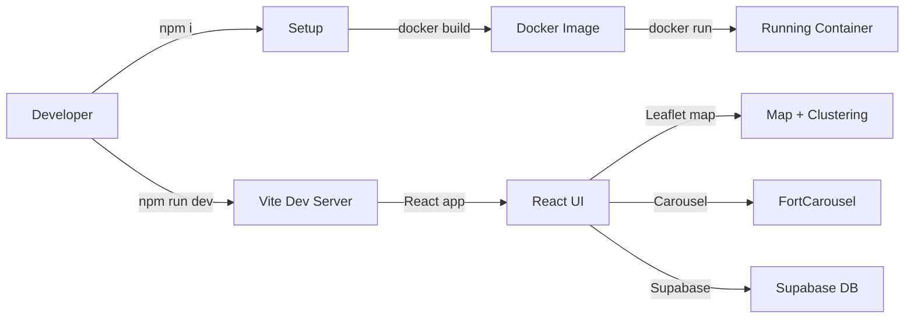

# Swaraj‑Website

A React 18 + Vite application that displays historic forts on a Leaflet map with clustering, shows a carousel of fort images, and integrates Supabase for authentication and favorites storage.

## Getting Started

```bash
# Install dependencies
npm ci

# Set up environment variables (Supabase) – copy the example and fill in your values
cp .env.example .env
# edit .env → VITE_SUPABASE_URL and VITE_SUPABASE_ANON_KEY

# Run the development server
npm run dev
# Open http://localhost:5173 in your browser
```

## Building for Production

```bash
npm run build   # creates the optimized ‘dist/’ folder
npm run preview # serves the built app locally (http://localhost:4173)
```

## Testing

- **Unit / component tests**
  ```bash
  npm test
  ```
- **End‑to‑end tests (Playwright)**
  ```bash
  npx playwright test
  ```

## Architecture Diagram



*The Docker‑related steps are retained in the diagram for reference but Docker is no longer required to run the project locally.*

## Supabase Setup

1. Create a Supabase project at https://app.supabase.com.
2. Enable Email‑Password authentication.
3. Create a `favorites` table with RLS policies (see `supabase_schema.sql` in the repo).
4. Populate `.env` with the `VITE_SUPABASE_URL` and `VITE_SUPABASE_ANON_KEY` values.

## CI / GitHub Actions

The workflow (`.github/workflows/ci.yml`) runs lint, unit tests, builds the production bundle, starts a dev server for Playwright, runs the E2E tests, and then stops the server. Docker steps have been removed.

## License

MIT © Swaraj‑Forts contributors